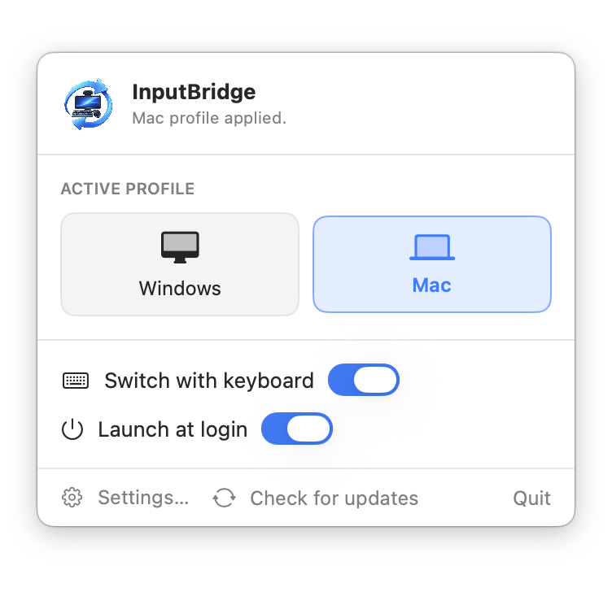
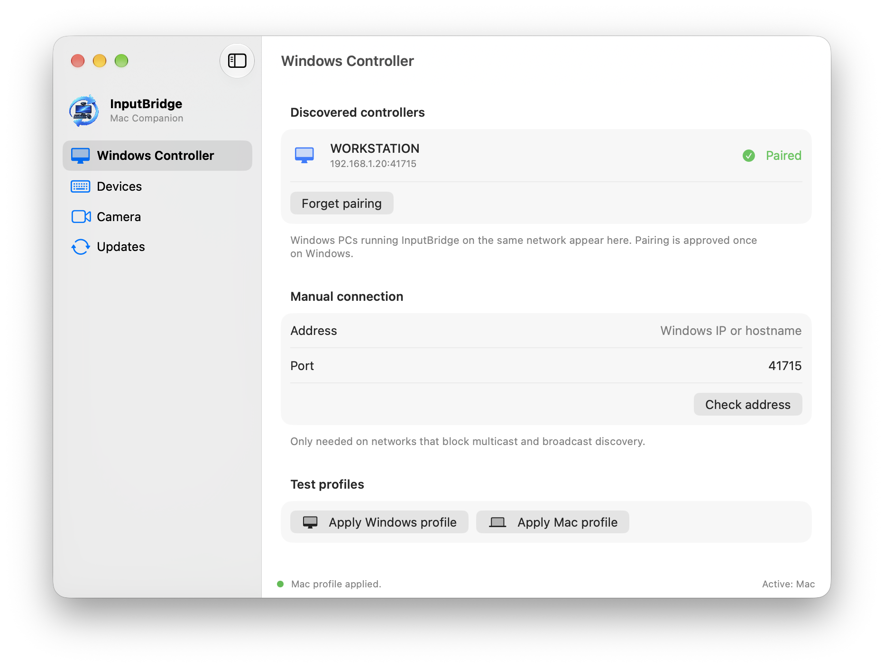
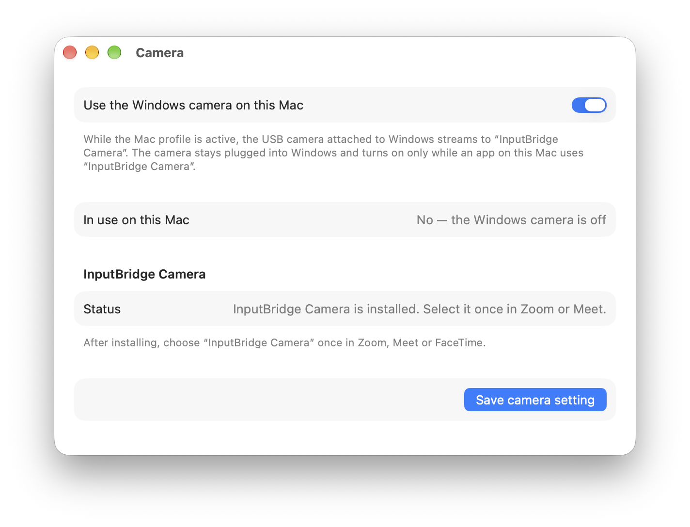

  

<h1 align="center">InputBridge</h1>

  <b>One desk, two computers.</b> 
  Move your monitors, speakers, keyboard and webcam between a Windows PC and a Mac with a single switch.

  
  
  
  

  <a href="https://github.com/ArdanucAKAR/InputBridge/releases/latest/download/InputBridge-macOS.pkg"><b>Download for Mac</b></a>
  &nbsp;·&nbsp;
  <a href="https://github.com/ArdanucAKAR/InputBridge/releases/latest/download/InputBridge-Windows-Setup.exe"><b>Download for Windows</b></a>
  &nbsp;·&nbsp;
  <a href="README_TR.md">Türkçe</a>

---

If your Windows PC and your Mac share the same monitors, speakers and keyboard, switching usually means pressing input buttons on every screen, changing the speaker source and re-pairing the keyboard. InputBridge does all of that for you: switch your Logitech keyboard to the Mac and the whole desk follows; switch it back and everything returns to Windows.

  <picture>
    <source media="(prefers-color-scheme: dark)" srcset="docs/images/mac-menu-dark.png">
    
  </picture>

## What it switches

| | Windows profile | Mac profile |
|---|---|---|
| **Monitors** (DDC/CI) | Windows input | Mac input |
| **Logitech Z407 speakers** | AUX | Bluetooth |
| **Logitech G915 / G913 keyboard** | LIGHTSPEED receiver | Bluetooth |
| **USB webcam** plugged into the PC | Used by Windows apps | Available on the Mac as **InputBridge Camera** |

- **Automatic** — switching the keyboard's host is enough. You can also pick a profile from the Mac menu bar or the Windows tray.
- **Your webcam on both computers** — the camera stays plugged into the PC. On the Mac it shows up as *InputBridge Camera* in Zoom, Meet, Teams or FaceTime, and it only turns on while one of those apps is actually using it.
- **No setup files or IP addresses** — the Mac finds the PC on your network by itself, and you approve the pairing once on Windows.
- **Stays up to date** — both apps update themselves from GitHub Releases.

## Screenshots

  <picture>
    <source media="(prefers-color-scheme: dark)" srcset="docs/images/mac-settings-dark.png">
    
  </picture>
   Mac settings: the Windows PC is found automatically and paired once.

  <picture>
    <source media="(prefers-color-scheme: dark)" srcset="docs/images/mac-camera-dark.png">
    
  </picture>
   InputBridge Camera brings the PC's webcam to the Mac and turns it on only when an app uses it.

## What you need

- A **Windows 10 or 11** PC and a **Mac with macOS 13 Ventura or later**, on the same home or office network.
- Monitors that support **DDC/CI** (most do; it may need to be turned on in the monitor's menu).
- Optional: **Logitech Z407** speakers, a **Logitech G915 / G913** keyboard paired with the PC's LIGHTSPEED receiver and with the Mac over Bluetooth, and a **USB webcam** plugged into the PC.

## Install

### 1. Windows

1. Download and run **[InputBridge-Windows-Setup.exe](https://github.com/ArdanucAKAR/InputBridge/releases/latest/download/InputBridge-Windows-Setup.exe)**.
2. InputBridge starts in the system tray. Open it and go to **Monitors**: tick the screens on your shared desk and choose which input each one uses for Windows and for the Mac (for example *DisplayPort 1* and *HDMI 1*).

### 2. Mac

1. Download and open **[InputBridge-macOS.pkg](https://github.com/ArdanucAKAR/InputBridge/releases/latest/download/InputBridge-macOS.pkg)**, then click **Continue** and **Install**. InputBridge opens by itself and lives in the menu bar.
2. Allow what macOS asks for, once:
   - **Bluetooth** — to talk to the keyboard and the speakers.
   - **Local network** — to find and talk to your PC.
   - **Camera** — so InputBridge can set up *InputBridge Camera*. It never turns a camera on by itself.
   - **InputBridge Camera** — in the window that appears, click **Open System Settings** and turn it on.
3. In **Settings… → Windows Controller**, your PC appears under *Discovered controllers*. Click **Pair**, then click **Approve** on the PC's **Pairing** page.

That's it. In Zoom, Meet or FaceTime, choose **InputBridge Camera** once.

## Everyday use

- **Switch the keyboard** to the Mac (Bluetooth) or back to the PC (LIGHTSPEED), and the monitors, speakers and camera follow.
- **Or pick a profile** — *Windows* or *Mac* in the Mac menu bar, or *Apply Windows / Mac profile* in the Windows tray menu.
- **Pause automation** with *Switch with keyboard* in the Mac menu if you want to move the keyboard without moving the rest of the desk.

## Troubleshooting

<b>My PC does not appear under Discovered controllers</b>

Make sure both computers are on the same network and that Windows treats it as a *Private* network (the installer only opens InputBridge's ports on private networks). If your router blocks discovery, enter the PC's IP address under *Manual connection* and click **Check address** — InputBridge remembers it.

<b>InputBridge Camera is black or missing</b>

- On the PC, open **Camera** and check that sharing is on and the right camera is selected.
- On the Mac, open **Settings… → Camera**. If it asks for camera access, click **Allow in System Settings…**, allow InputBridge, then quit and reopen InputBridge.
- The camera only streams while the Mac profile is active; on the Windows profile it stays with Windows apps.

<b>A monitor does not switch</b>

Turn on DDC/CI in the monitor's on-screen menu and check the input codes on the PC's **Monitors** page. Common values are `0x0F` (DisplayPort 1), `0x11` (HDMI 1) and `0x12` (HDMI 2).

## Privacy and security

- InputBridge only works on your local network; nothing goes through the internet except update checks against GitHub.
- A Mac can only control the PC after you approve its pairing on Windows. The pairing key is stored in the Mac's Keychain.
- The webcam stream goes directly from your PC to your Mac, and only while an app on the Mac is using InputBridge Camera.
- Do not expose the PC's InputBridge port to the internet. See [SECURITY.md](SECURITY.md).

## Contributing

Bug reports and pull requests are welcome. Building from source and the release process are described in [docs/DEVELOPMENT.md](docs/DEVELOPMENT.md).

## License

[MIT](LICENSE)
